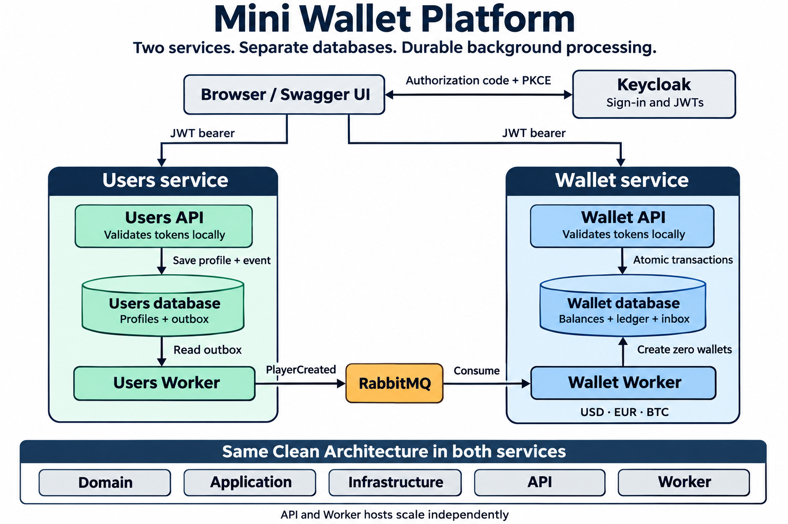

# Mini Wallet Platform

A .NET 10 backend for player profiles and wallets in **USD, EUR and BTC**. Keycloak handles sign-in; the Users and Wallet services handle the platform's business rules.

## Run locally

Install Docker Desktop with Linux containers, then run from the repository root:

```sh
docker compose up --build
```

Wait for the APIs to start. Docker starts the databases, message broker and identity provider, and applies database migrations automatically. No local .NET installation is needed to run the system.

| Open | URL |
| --- | --- |
| Users API and Swagger | http://localhost:5101/swagger |
| Wallet API and Swagger | http://localhost:5102/swagger |
| Live balance test page | http://localhost:5102/live-balances |
| Keycloak | http://localhost:8080 |
| Email inbox (Mailpit) | http://localhost:8025 |

| Test account | Username | Password |
| --- | --- | --- |
| Player | `player` | `Player123!` |
| Admin | `admin` | `Admin123!` |
| Keycloak management | `keycloak-admin` | `LocalKeycloak123!` |

These accounts and the HTTP setup are for local development only. Run `docker compose stop` to stop the system while keeping its data; `docker compose up -d` starts it again.

## Try it out

Prefer Postman? Import the [collection and local environment](postman/README.md) for guided requests with response checks.

In either Swagger UI, select **Authorize → oauth2**, keep the client ID, select the **openid, profile and email** scopes, then sign in at Keycloak. Both APIs use authorization code with PKCE and JWT bearer tokens.

To switch accounts, log out in Swagger's authorization dialog and authorize again. If Keycloak keeps the previous username, select **Restart login** beside it. Use the business **admin** account for wallet operations, not the Keycloak management account.

1. Sign in as **player** in Users Swagger. POST `/api/v1/profiles` with:

   ```json
   { "displayName": "Demo Player" }
   ```

   Copy the returned `playerId`.
2. Sign in as **player** in Wallet Swagger. GET `/api/v1/wallets/me`. All three wallets start at zero. If provisioning is still running, a 409 response means you should retry after two seconds.
3. Use POST `/api/v1/transactions` for each row below. Select the matching Swagger example, replace the indicated ID, and enter the **Idempotency-Key**.

   | Account | Example | Amount | Replace | Idempotency-Key |
   | --- | --- | --- | --- | --- |
   | Admin | BONUS | USD 100 | `playerId` from step 1 | `demo-bonus-1` |
   | Player | BET | USD 10 | Nothing; copy the returned `transactionId` | `demo-bet-1` |
   | Admin | WIN | USD 15 | `betId` with the BET's `transactionId` | `demo-win-1` |

4. Switch back to **player**. GET `/api/v1/wallets/me` should show **USD 105**, EUR 0 and BTC 0. GET `/api/v1/transactions/me` should show three transactions.
5. Repeat each POST using its original account, payload and key. The result is replayed without changing the balance or adding another transaction.

This walkthrough assumes a player with no previous transactions. For a fresh account, choose **Register** on the Keycloak sign-in page, verify the email through Mailpit, set the initial password when prompted, then create a profile. See the [registration guide](docs/technical-guide.md#fresh-registration-and-verification) if sign-in expires during verification.

### Watch live balances

Open http://localhost:5102/live-balances, paste the player's access token and click **Connect**. Send a BET, BONUS or WIN in Swagger or Postman with a new idempotency key. The affected player's balances update automatically. Reusing a key does not create a new update. When the token expires, get a fresh one and reconnect.

The page keeps the token in memory. SignalR and Redis relay notifications across API instances; balances reload after reconnecting and periodically to recover missed updates. See the [live update contract](docs/technical-guide.md#live-balance-updates) for integration details.

## Architecture



Both services use the same Clean Architecture structure:

| Project | Responsibility |
| --- | --- |
| Domain | Business rules and entities |
| Application | Use cases, permissions and repository interfaces |
| Infrastructure | PostgreSQL persistence and RabbitMQ messaging |
| API | HTTP endpoints, validation and authentication |
| Worker | Background event processing |

Each service owns its database. APIs and workers run separately and can scale independently. An outbox/inbox makes wallet creation durable; database transactions, row locks and idempotency keys protect money operations from concurrent requests and retries.

Provider-specific claims stay at the API boundary. Profiles and wallets use a stable platform `PlayerId`, so changing identity providers does not require rewriting business rules.

## Run tests

Install **.NET SDK 10.0.404** and keep Docker running:

```sh
dotnet test MiniWalletPlatform.sln
```

Tests start their own PostgreSQL and RabbitMQ containers; the application stack does not need to be running. Coverage includes authorization, money precision, concurrent spending, safe retries, wallet provisioning and outage recovery.

SignalR tests also start Redis and verify player isolation, delivery between API instances and notification outages. With Node.js 18 or later, run `node --test tests/live-balances-client.test.mjs` for the test page's balance synchronization checks.

## Scope and details

- Players can manage their profile and view their own balances/history. Admins can access any player's data.
- BET debits the player's wallet. Admin-only WIN settles a successful BET once; BONUS funds the demo. Wallets cannot go below zero.
- Amounts are JSON strings: USD/EUR support two decimal places; BTC supports eight.
- SignalR provides live balance updates with a small manual test page. The full frontend, game engine, currency conversion, production deployment and automated identity migration remain outside this take-home's scope.

See the [technical guide](docs/technical-guide.md) for API rules, error responses, pagination and failure handling, or the [design notes](docs/superpowers/specs/2026-11-13-mini-wallet-platform-design.md) for architectural decisions.
